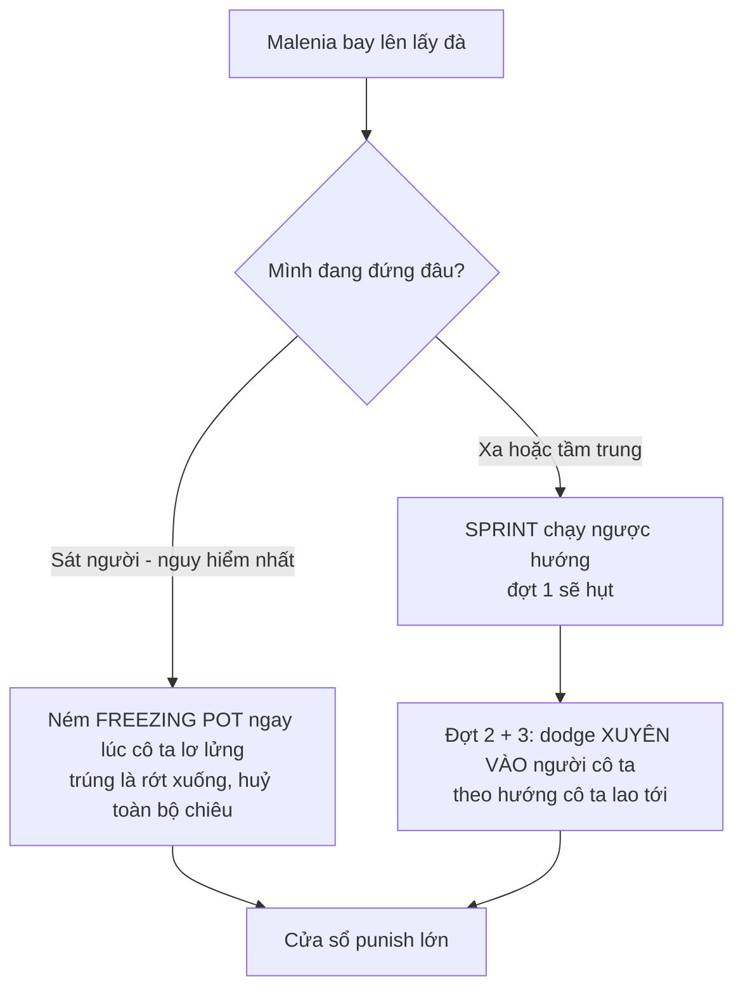

# 🗡️ Elden Ring - Solo Malenia No-Hit: 2 Build theo đồ có sẵn trong save

> Guide viết riêng cho nhân vật **dyu (slot 1)** - đọc trực tiếp từ `ER0000.sl2` ngày **2026-08-06**: Level 713, **cả 8 chỉ số đều 99**, đã mở DLC Shadow of the Erdtree.
> Không cần respec, không cần cày level. Mọi thứ bên dưới chỉ xoay quanh: lắp đồ gì, đi lấy gì, và đánh như thế nào.

---

## Mục lục
1. [TL;DR](#1-tldr)
2. [Audit đồ trong save](#2-audit-đồ-trong-save)
3. [Luật chơi riêng của trận Malenia](#3-luật-chơi-riêng-của-trận-malenia)
4. [Build 1 - Song katana Bleed](#4-build-1---song-katana-bleed)
5. [Build 2 - Colossal Jump Attack](#5-build-2---colossal-jump-attack-stance-break-loop)
6. [Waterfowl Dance và Phase 2](#6-waterfowl-dance-và-phase-2)
7. [Checklist đồ cần đi lấy](#7-checklist-đồ-cần-đi-lấy)
8. [Nguồn đã verify](#8-nguồn-đã-verify)

---

## 1. TL;DR

| Build | Trạng thái | Còn thiếu |
|---|---|---|
| **Build 1 - Song katana bleed** | Bản Rivers of Blood + Blood Uchigatana **đánh được ngay tối nay** | Bản chuẩn (2x Uchigatana Seppuku): Seppuku đã có, chỉ cần **nhân bản** ở thợ rèn (Lost Ashes of War sẵn 999) |
| **Build 2 - Colossal jump attack** | Bản Greatsword + Zweihander chạy được sau ~5 phút nâng cấp (đá thừa sẵn) | Bản BIS thiếu **Bloodfiend's Arm** (farm DLC, nên lấy 2 cây) |
| **Vũ khí phụ chống Waterfowl** | Nguyên liệu Freezing Pot đã thừa (999 Rimed Crystal Bud, 10 Ritual Pot) | Thiếu **Glintstone Craftsman's Cookbook [6]** để mở recipe |

Cả hai build cùng một triết lý: **Malenia phòng thủ rất kém, chỉ nguy hiểm khi được phép ra đòn**. Đè cô ta bằng stagger (bleed proc hoặc stance-break) thì Waterfowl gần như không có cơ hội xuất hiện, và không bị đánh trúng thì cô ta cũng không hút máu hồi lại được.

---

## 2. Audit đồ trong save

### Chỉ số
Cả 8 stat đều **99** (Vigor, Mind, Endurance, Strength, Dexterity, Intelligence, Faith, Arcane). Arcane 99 nghĩa là tốc độ tích bleed trên vũ khí Blood đã max sẵn. Endurance 99 cho equip load tối đa, đeo 2 colossal + giáp vừa vẫn medium roll thoải mái (giữ load dưới 70%).

### Đồ liên quan đã có ✓

| Nhóm | Item |
|---|---|
| Katana | **2x Blood Uchigatana +25**, Rivers of Blood +10 (max), Nagakiba +25 |
| Colossal | Giant-Crusher +25, Greatsword +0, Zweihander +0, Starscourge Greatsword +0 |
| Talisman | Rotten Winged Sword Insignia, Millicent's Prosthesis, Lord of Blood's Exultation, Shard of Alexander, Claw Talisman, Winged Sword Insignia, Axe Talisman |
| Slot talisman | 3 Talisman Pouch = đủ **4 slot** |
| Giáp | **White Mask** (buff +10% damage 20s sau mỗi bleed proc gần đó) |
| Physick tear | **Thorny Cracked Tear** (buff đòn đánh liên tiếp), **Stonebarb Cracked Tear** (tăng stance damage), Opaline Hardtear, Spiked Cracked Tear... |
| Ash of War | **Seppuku** (đang gắn trên vũ khí khác nên không hiện trong túi đồ), **Lion's Claw** (chủ lực build 2), Raptor of the Mists, Golden Parry... |
| Nhân bản ash | **999 Lost Ashes of War** - đưa thợ rèn để nhân bản Seppuku thành nhiều bản |
| Nguyên liệu | 999 Rimed Crystal Bud, 10 Ritual Pot, 20 Cracked Pot, 5 Freezing Grease |
| Đá nâng cấp | 96 Ancient Dragon Smithing Stone, 65 Somber Ancient Dragon, đủ đá 1-8 cả 2 loại |

Kết luận audit: **bộ khung 2 build đã nằm sẵn trong túi**, chỉ thiếu 3 món bắt buộc (mục 7).

---

## 3. Luật chơi riêng của trận Malenia

1. **Hút máu khi chạm đòn, kể cả khi mình block.** Mỗi đòn trúng người (hoặc trúng khiên) hồi máu cho cô ta. Vì vậy khiên là lựa chọn tệ nhất riêng trận này, và mục tiêu no-hit trùng hoàn toàn với mục tiêu giết nhanh. Đòn đánh hụt thì không hồi.
2. **Rất yếu với bleed.** Bleed proc trừ máu theo phần trăm và tạo khựng, cắt combo của cô ta. Frost cũng dính tốt (Freezing Pot dựa vào điều này).
3. **Stance rất thấp so với tốc độ đòn của mình.** Jump attack bằng colossal vài phát là gãy thế, mở riposte. Đây là nền tảng của build 2.
4. **Không có nhiều hyper-armor ở phase 1.** Đánh liên tục là cô ta bị khựng liên tục, càng hung hãn càng an toàn.
5. **Waterfowl Dance là trở ngại no-hit duy nhất thật sự.** Toàn bộ mục 6 dành cho nó.

---

## 4. Build 1 - Song katana Bleed

### 4.1 Bản đánh ngay hôm nay (không thiếu món nào)

| Slot | Đồ |
|---|---|
| Tay phải | **Rivers of Blood +10** |
| Tay trái | **Blood Uchigatana +25** (powerstance, cùng loại katana) |
| Talisman | Rotten Winged Sword Insignia + Millicent's Prosthesis + Lord of Blood's Exultation + **Shard of Alexander** |
| Giáp | White Mask + giáp tuỳ thích (giữ medium roll) |
| Physick | **Thorny Cracked Tear + Stonebarb Cracked Tear** |

Cách đánh: giữ L1 chain (đòn powerstance 2 kiếm) làm nhịp chính, chen **Corpse Piler** (skill RoB, được Shard of Alexander buff) khi có cửa sổ dài. Bleed proc liên tục kích White Mask + Lord of Blood's Exultation (+30% damage tổng cộng), Rotten Winged Sword Insignia + Millicent's Prosthesis buff dần theo chuỗi đòn liên tiếp.

### 4.2 Bản chuẩn (nhân bản Seppuku là chạy)

Thay RoB bằng cây **Blood Uchigatana +25 thứ hai** (anh có sẵn 2 cây), gắn **Seppuku** cho cả hai, giữ Blood affinity. Seppuku đã có sẵn (đang nằm trên vũ khí khác); để cùng lúc nằm trên 2 kiếm thì đến thợ rèn **Hewg ở Roundtable Hold**, chọn **Duplicate Ash of War**, tốn 1 Lost Ashes of War mỗi bản (đã set sẵn 999 viên trong save ngày 2026-08-06). Talisman đổi Shard of Alexander thành Claw Talisman nếu hay mở combo bằng jump L1, còn lại giữ nguyên.

Buff trước khi vào sương mù: bấm Seppuku ở tay phải, sau đó two-hand kiếm trái và bấm Seppuku lần nữa, rồi trở về powerstance. Buff kéo dài 60 giây, hết thì bù lại lúc cô ta chuyển phase. Seppuku cộng thẳng attack power + tốc độ tích bleed, nên chuỗi L1 proc bleed nhanh hơn hẳn bản RoB.

Vì sao bản này mạnh hơn: L1 powerstance của 2 katana thường ra đòn nhanh hơn và ít bị hở hơn Corpse Piler, mà bleed lại tích trên **cả hai lưỡi kiếm được Seppuku buff**.

### 4.3 Nhịp trận đấu

1. Vào sương mù, buff Seppuku (bản 4.2), uống physick.
2. **Đừng áp sát ngay.** Đứng tầm trung dụ cô ta ra đòn trước, né rồi mới bám vào. Waterfowl mở màn khi mình đang đứng sát là tình huống chết người nhất trận.
3. Bám sát hông phải của cô ta, L1 chain 2-4 đòn rồi nhả, lặp. Bleed proc là cửa sổ dài, dồn thêm một chuỗi nữa.
4. Thấy cô ta bay lên lấy đà: xử lý theo mục 6.
5. Phase 2: né Scarlet Aeonia (mục 6), sau đó là cửa sổ punish lớn nhất trận, dồn hết mọi thứ.

### 4.4 Hướng nâng cấp DLC (tuỳ chọn, không bắt buộc cho Malenia)

Great Katana affinity Blood/Occult + Seppuku là bản nâng dài hạn của build này, đã có lộ trình chi tiết trong [elden-ring-bleed-katana-build-guide.md](elden-ring-bleed-katana-build-guide.md) (mục Phase 4 DLC). Riêng để giết Malenia thì dual Uchigatana đã là đúng công cụ, không cần chờ.

---

## 5. Build 2 - Colossal Jump Attack (stance-break loop)

### 5.1 Vì sao build này gần như "tắt điện" Malenia

Jump attack bằng 2 colossal dồn stance damage cực lớn. Malenia cứ ăn khoảng 3-4 cú jump L1 là gãy thế một lần, mở riposte. Chu kỳ "jump - jump - jump - gãy thế - riposte" lặp đến hết trận, cô ta hầu như không có lượt đánh, tức là không có Waterfowl, không có hút máu. Đây là hướng ít phụ thuộc kỹ năng né nhất để no-hit.

### 5.2 Bản dùng đồ có sẵn (chạy được sau ~5 phút)

- **Greatsword + Zweihander**, cả hai nâng **+25** ngay tại grace (đá 1-8 và 96 viên Ancient Dragon có thừa), affinity Heavy hoặc Blood.
- Gắn **Lion's Claw** (đã có) vào cây tay phải làm nút phá thế dự phòng khi cô ta gần gãy stance mà mình chưa kịp nhảy.
- Lưu ý powerstance theo class: Greatsword, Zweihander, Starscourge cùng là **Colossal Sword** nên ghép được với nhau. **Giant-Crusher là class Colossal Weapon**, hiện chưa có cây thứ hai cùng class nên tạm chưa ghép đôi được.

| Slot | Đồ |
|---|---|
| 2 tay | Greatsword +25 / Zweihander +25 |
| Talisman | **Claw Talisman** + Rotten Winged Sword Insignia + Millicent's Prosthesis + Lord of Blood's Exultation (nếu chạy affinity Blood) hoặc Shard of Alexander (nếu chạy Heavy + Lion's Claw) |
| Giáp | White Mask (nếu chạy Blood) + giáp vừa |
| Physick | **Stonebarb Cracked Tear + Thorny Cracked Tear** |

### 5.3 Bản BIS (thiếu Bloodfiend's Arm, farm ở DLC)

**Bloodfiend's Arm** là colossal weapon DLC: nhận affinity + Ash of War tự chọn, bleed buildup thuộc hàng cao nhất game, cộng đồng gọi thẳng là "easy button". Lộ trình nâng dần:

1. Farm **1 cây** → ghép ngay với **Giant-Crusher +25** có sẵn (cùng class Colossal Weapon, powerstance được liền).
2. Farm **cây thứ hai** → bản hoàn chỉnh: **2x Bloodfiend's Arm +25, affinity Blood, Ash of War Lion's Claw**, jump L1 vừa phá thế vừa tích bleed hai nguồn. Đây là điểm hội tụ của cả hai build: stance-break loop CỘNG bleed proc.

Talisman bản BIS: Claw Talisman + Rotten Winged Sword Insignia + Millicent's Prosthesis + Lord of Blood's Exultation, đội White Mask.

### 5.4 Nhịp trận đấu

1. Uống physick (Stonebarb) trước khi vào.
2. Mở màn vẫn đứng tầm trung dụ đòn như build 1, né đòn đầu rồi vào nhịp.
3. **Jump L1 là nút duy nhất cần nhớ.** Nhảy vào đánh, chạy chỉnh vị trí, nhảy tiếp. Gãy thế thì riposte, đứng dậy đánh tiếp không cho cô ta thở.
4. Nếu Waterfowl vẫn kịp ra (hiếm): xử lý theo mục 6. Khoảng cách của jump attack thực ra là lợi thế, vì mình thường ở ngoài tầm flurry đầu tiên.

---

## 6. Waterfowl Dance và Phase 2

### 6.1 Waterfowl Dance

Dấu hiệu: cô ta **bay lơ lửng lên cao, thu kiếm về thế thủ** trong khoảng một giây rồi lao xuống 3 đợt chém.

- **Freezing Pot** là bảo hiểm quan trọng nhất: ném trúng lúc cô ta đang lơ lửng lấy đà là chiêu bị huỷ hoàn toàn. Mang theo 3-5 bình mỗi lần vào (nguyên liệu anh thừa để chế cả trăm bình, chỉ thiếu cookbook, xem mục 7).
- Cách phòng bệnh tốt hơn chữa bệnh: **đầu trận đứng tầm trung dụ cô ta ra Waterfowl sớm** khi mình còn khoảng cách an toàn, xử xong mới vào nhịp chính.
- Trong nhịp đánh, đừng tham quá 4 đòn liên tục khi cô ta còn đứng, chừa stamina để sprint là luôn thoát được đợt 1.

### 6.2 Phase 2

| Chiêu | Cách xử |
|---|---|
| **Scarlet Aeonia** (mở màn phase, bay lên nở hoa) | Sprint lùi ra xa, dodge nhịp cuối lúc cô ta đáp. Sau khi hoa nở là **cửa sổ punish dài nhất trận**, cô ta đứng yên vài giây. |
| **Phantom Strike** (phân thân lao liên tiếp) | Sprint lùi thẳng một hướng là toàn bộ phân thân đánh hụt. Đừng dodge sớm. |
| Waterfowl phase 2 | Y hệt phase 1, Freezing Pot vẫn huỷ được. |
| Scarlet Rot dính lẻ | Mục tiêu là không bị chạm, nhưng cứ mang vài **Preserving Boluses** phòng thân. |

---

## 7. Checklist đồ cần đi lấy

Một việc làm tại Roundtable Hold, hai món cần đi lấy, một món tuỳ chọn. Cột cuối là đường tắt bằng save editor trong repo nếu lười chạy (nhớ luật: **đóng game hẳn trước khi chạy editor**).

| # | Món | Cho | Cách lấy | Đường tắt editor |
|---|---|---|---|---|
| 1 | **Nhân bản Seppuku** (ash đã có, cần bản thứ 2) | Build 1 bản chuẩn | Thợ rèn **Hewg, Roundtable Hold** > Duplicate Ash of War, tốn 1 Lost Ashes of War mỗi bản (**save đã có sẵn 999 viên**, set ngày 2026-08-06). | đã xong bước Lost Ashes of War bằng `set-qty` |
| 2 | **Glintstone Craftsman's Cookbook [6]** | Recipe Freezing Pot (chống Waterfowl, cả 2 build) | **Caria Manor** (Liurnia): từ grace Manor Main Gate đi theo tường bên phải sân, căn phòng nhỏ đầu bậc thang, sách trên xác chết. | `add-item` |
| 3 | **Bloodfiend's Arm x2** | Build 2 bản BIS | DLC, **Prospect Town** (Gravesite Plain, nam grace Cliffroad Terminus): Bloodfiend nào **cầm cây chùy tay** đều rớt được, con đầu rớt chắc, farm tiếp để lấy cây thứ hai. | `replace-weapon` từ 2 vũ khí rác |
| 4 | (Tuỳ chọn) **Viridian Hidden Tear** | Physick xoá sạch tốn stamina 15 giây, hợp nhịp jump attack build 2 | DLC, Furnace Golem ở **Charo's Hidden Grave** (đường vòng từ Grand Altar of Dragon Communion). | `add-item` |

Sau khi nhân bản Seppuku và có cookbook [6]:
- Gắn Seppuku vào cả 2 Blood Uchigatana (giữ Blood affinity).
- Chế 5 Freezing Pot tại grace (2 Rimed Crystal Bud + 1 Ritual Pot mỗi bình, anh có 999 bud + 10 pot).
- Nâng Greatsword + Zweihander lên +25 nếu muốn chạy build 2 trước khi farm DLC.

---

## 8. Nguồn đã verify

Trạng thái nhân vật đọc trực tiếp từ save bằng `elden_ring_save_editor.py` (list, list-items, stats slot 1) ngày 2026-08-06. Vị trí item đối chiếu wiki ngày 2026-08-06:

- Freezing Pot cần Glintstone Craftsman's Cookbook [6]: https://eldenring.wiki.fextralife.com/Freezing+Pot
- Vị trí cookbook [6] ở Caria Manor: https://eldenring.wiki.fextralife.com/Glintstone+Craftsman's+Cookbook+(6)
- Ash of War: Seppuku, scarab tàng hình hồ băng: https://eldenring.wiki.fextralife.com/Ash+of+War:+Seppuku
- Bloodfiend's Arm, colossal weapon DLC, rớt ở Prospect Town, không phải unique: https://eldenring.wiki.fextralife.com/Bloodfiend's+Arm và https://www.polygon.com/elden-ring-shadow-erdtree-guide/24186733/bloodfiends-arm-location-where-to-find-dlc-sote/
- Viridian Hidden Tear, Furnace Golem ở Charo's Hidden Grave: https://eldenring.wiki.fextralife.com/Viridian+Hidden+Tear

Cơ chế trận đấu (hút máu xuyên block, bleed/frost hiệu quả, Freezing Pot huỷ Waterfowl, nhịp né 3 đợt Waterfowl) là kiến thức cộng đồng đã kiểm chứng rộng rãi, không verify lại từng nguồn.
